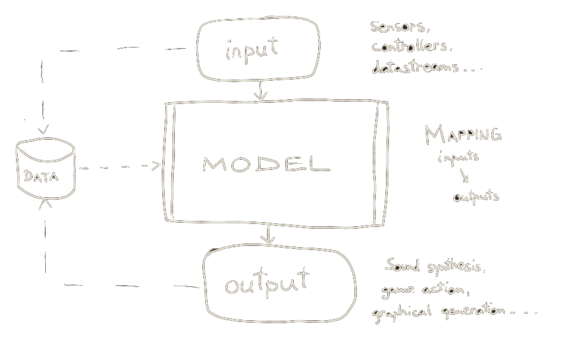
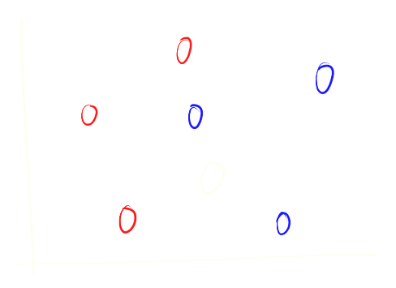
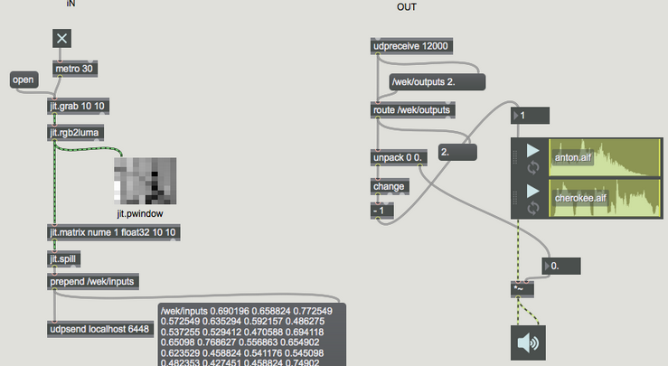

class: center, middle
.title[Interactivity Design 1]
  
.subtitle[iML w/ Wekinator]
      
.date[Oct 2026] 
   
.note[Created with [Liminal](https://github.com/jonathanlilly/liminal) using [Remark.js](http://remarkjs.com/) + [Markdown](https://github.com/adam-p/markdown-here/wiki/Markdown-Cheatsheet) +  [KaTeX](https://katex.org)]

???

Author: Grigore Burloiu, UNATC
    
---
name: toc
class: left
# ★ Table of Contents ★      <!-- omit in toc -->
      
1. [ML representations](#ml-representations)
2. [Supervised learning](#supervised-learning)
3. [Classification](#classification)
4. [Inputs](#inputs)
5. [Wekinator example](#wekinator-example)

        
<!-- Comment out the next slide if you don't want the Table of Contents link -->         
---
layout: true  .toc[[★](#toc)]
        
---

name: ml-representations  
class: left
# ML representations

.right-column[
<iframe width="100%" src="https://www.youtube.com/embed/LSS_bos_TPI" title="YouTube video player" frameborder="0" allow="accelerometer; autoplay; clipboard-write; encrypted-media; gyroscope; picture-in-picture" allowfullscreen></iframe>
]

a data**point** is a [vector](https://natureofcode.com/book/chapter-1-vectors/)
      

--

a **dataset** is a collection of points / vectors
      

--

a **model** *fits* the dataset onto a [*latent space*](https://stats.stackexchange.com/a/442360)

---
name: types-of-ml  
class: left
## Types of ML

*how* is the model trained? ~ *how* is the latent space formed?

--

supervised (90% of this semester)
- based on user-labelled data

--

unsupervised (9%)
- finding underlying structure in data

--

reinforcement (?)
- desired actions based on feedback from the environment

---
name: supervised-learning
class: left
# Supervised learning

input-output pairs are learned together

input ~ *data*, output ~ *label* 

--

→ input+output ~ *labelled data*

---
## sup.ML tasks

.left-column[
    classification

]

--

.right-column[
    regression

]

--

          
temporal modelling
- classification/regression *over time*

---
name: classification
# Classification

assign a *label* to an input

- in: raw data and/or *features*
- out: label_1 OR label_2 OR ... label_n

---
name: inputs
# Inputs

time series data

[examples @ Wekinator](http://www.wekinator.org/examples/#Pick_Choose_Inputs)

- misc: [hand tracking (Python)](https://github.com/RVirmoors/cc-patterns/tree/main/Python/HandTracking_OSC), [Mediapipe in Max](https://github.com/lysdexic-audio)

---
name: wekinator-example
# Wekinator example

[image classification : sound](https://github.com/RVirmoors/cc1/blob/master/ml/classification.maxpat)

---
## Wekinator: new project

1. listening port
   
2. number of inputs 
   - (features: MFCCs, pixel brightness, x,y,z coords etc.)
   
3. number of outputs 
   - (how many things are we controlling?)
   
4. outputs type
   - classifier, continuous (regression), DTW (temporal)
   
5. target IP:port

---
## Wekinator: usage

1. set desired output value(s)
   
2. Start recording inputs ... stop
   
3. again 1.-2. for all desired in-out combinations
   
4. Train: the ML model
   
5. Run: now inputs directly control the outputs